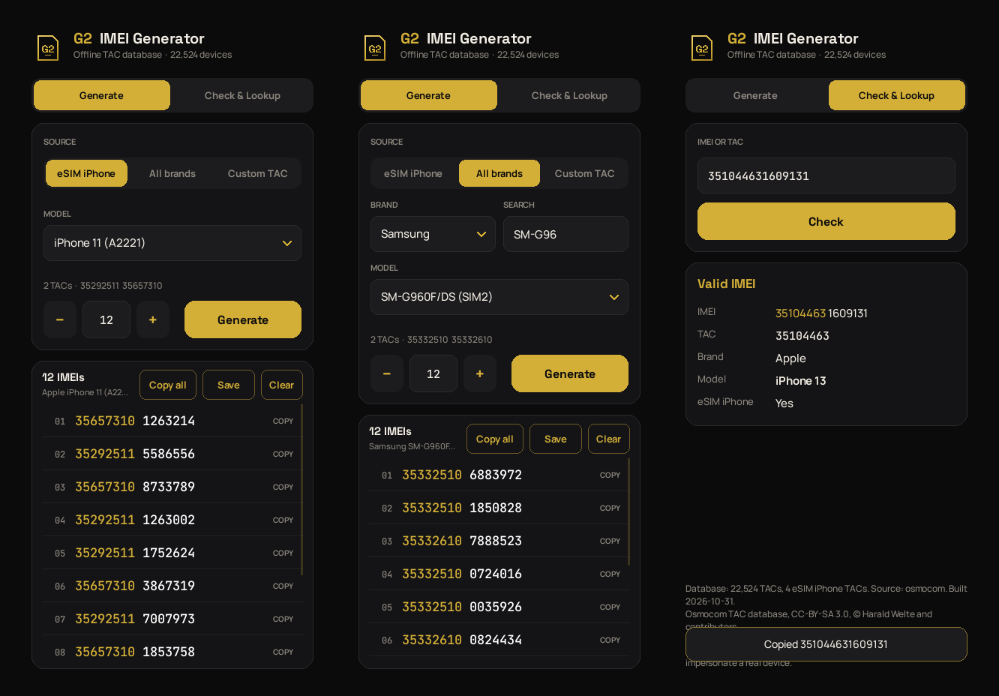

<p align="center"></p>

<h1 align="center">G2 IMEI Generator</h1>

<p align="center"></p>

An Android app (Kivy + Buildozer) with a black and gold design that generates **checksum-valid test IMEIs** and looks up
TACs against an **embedded, offline TAC database** of 22,500+ device types from 560+ brands.
It has a preset for eSIM-capable iPhones.

**Built by [IamG2](https://github.com/G33l0/IamG2).**

---

## What it is (and isn't)

It generates numbers. It is **not** an IMEI changer. It produces 15-digit strings that pass
the Luhn checksum and start with a real TAC (Type Allocation Code). It does **not** write to
device hardware, activate eSIM profiles or get around carrier restrictions. Android doesn't
let apps change a phone's IMEI.

It's meant for QA, test fixtures, form-validation testing, teaching and development work
that needs device identities that look realistic. Using a generated IMEI on a live network,
or to pretend to be a real device, is illegal in most countries.

## Features

- **Embedded TAC database** (`data/tac.sqlite`, about 2 MB). Works fully offline and is bundled inside the APK.
- Three sources:
  - **eSIM iPhones**: verified Apple TACs for eSIM models (XR / XS / 11 and later / SE 2nd and 3rd gen)
  - **All brands**: pick any brand, search models by name or TAC prefix
  - **Custom TAC**: any 8-digit TAC, labelled with its device name if the TAC is known
- **Batch generation** of 1 to 1000 IMEIs, all different within a batch. Uses a cryptographically secure RNG.
- **Copy** to the clipboard, and **Share** through the Android share sheet (Drive, email, Notes and so on), or **Save CSV** on desktop
- **Check & Lookup** tab: says whether any IMEI is valid (spaces and dashes are fine) and shows which device a TAC belongs to. The app never shows how it verifies numbers; messages are just "Valid IMEI" or "Invalid IMEI"
- Also works from the command line: `python imei_generator.py 35104463 10`

---

## Design

Black and gold theme: background `#0B0B0C`, cards `#141416`, gold `#D4AF37`, ivory text
`#F2EDE3`. Type is set in **Manrope** (interface), **Space Grotesk** (headings, logo) and
**JetBrains Mono** (numbers), all bundled under the SIL Open Font License (`assets/fonts/`).
Generated IMEIs are shown with the TAC (device type) in gold and the rest in ivory. Tap any row to copy that single IMEI.

The logo is a gold SIM-card outline with a G2 monogram. It's generated by
`tools/make_logo.py`, which outputs `assets/logo.png`, the launcher icons (legacy plus
adaptive foreground and background) and the presplash. Edit the script and re-run it to tweak the mark.

## About the TAC data

The database comes from the **[Osmocom TAC database](http://tacdb.osmocom.org)**
(CC-BY-SA 3.0, © Harald Welte and contributors), plus any TACs you add yourself in
`data/tac_extra.csv`.

> **Correction to earlier versions:** the old `tac_db.json` had TACs that couldn't be
> verified. Most weren't in any public source, the same TAC was listed for several models,
> and `35332510` is actually a **Samsung Galaxy S9 (SM-G960F/DS)**, not an iPhone. That
> file has been removed.

Public data on recent iPhones is thin. Osmocom has these eSIM iPhone TACs:

| TAC      | Model                |
|----------|----------------------|
| 35727609 | iPhone XS Max        |
| 35292511 | iPhone 11 (A2221)    |
| 35657310 | iPhone 11 (A2221)    |
| 35104463 | iPhone 13            |

To cover more models (XR, 12, 14, 15, 16, SE), add TACs you have verified to
`data/tac_extra.csv`. Good sources are the first 8 digits of the IMEI on a test device you
own (*Settings > General > About*, or dial `*#06#`), or a box label.

```csv
tac,brand,model,aka,esim
35XXXXXX,Apple,iPhone 15,A3090,1
```

Then rebuild the database (see below). The official GSMA IMEI database is paid and
restricted, so don't scrape it.

---

## Setting up the APK with the full TAC database embedded

The database is a normal file at `data/tac.sqlite`, and `buildozer.spec` already packages it
(`source.include_exts` includes `sqlite`, and the `sqlite3` recipe is in `requirements`). A
ready-built copy is committed, so **every APK you build already has the full database**. You
only need step 1 if you want to refresh it or add your own TACs.

### 1. (Optional) Refresh or extend the database

```bash
python3 tools/build_tac_db.py                 # downloads the latest Osmocom CSV + merges tac_extra.csv
# or, offline / behind a proxy:
curl -o tacdb.csv http://tacdb.osmocom.org/export/tacdb.csv
python3 tools/build_tac_db.py --csv tacdb.csv
# only your own TACs, no Osmocom:
python3 tools/build_tac_db.py --no-osmocom
```

The script prints the result, for example:
`Wrote data/tac.sqlite: 22524 TACs, 566 brands, 4 eSIM iPhone TACs (osmocom)`.

### 2. Build the APK

#### Option A: GitHub Actions (easiest, nothing to install)

This repo includes `.github/workflows/build-apk.yml`.

1. Push to `main` (or open **Actions → Build APK → Run workflow**).
2. Wait for the run to finish. The first build takes about 20–30 minutes; later runs are faster because the cache is reused.
3. Download the **g2-imei-generator-apk** artifact from the run page and unzip it. You'll get `g2imeigen-1.2.0-arm64-v8a_armeabi-v7a-debug.apk`.

#### Option B: Linux / WSL2 (recommended for local builds)

```bash
sudo apt update
sudo apt install -y python3 python3-pip python3-venv git zip unzip openjdk-17-jdk \
    autoconf automake libtool pkg-config zlib1g-dev libncurses-dev cmake libffi-dev libssl-dev

git clone https://github.com/G33l0/imei-generator.git
cd imei-generator

python3 -m venv .venv && source .venv/bin/activate
pip install --upgrade pip setuptools wheel
pip install buildozer "cython<3"

python -m unittest discover -s tests       # optional sanity check
buildozer -v android debug                 # first run downloads the SDK/NDK (~3 GB)
```

The APK is written to `bin/`. **Don't run `buildozer init`.** That would overwrite the
`buildozer.spec` that's already set up.

#### Option C: Termux (experimental)

Buildozer doesn't officially support building on Android itself, and NDK toolchains often
fail there. Use Option A from your phone instead: push the code, then download the APK
from the Actions page.

### 3. Install on your phone

- **USB:** `adb install -r bin/*.apk` (turn on USB debugging first), or `buildozer android deploy run logcat`
- **Manually:** copy the APK to the phone, open it, and allow *Install unknown apps* for your file manager.

### 4. Check that the database is embedded

Open the app, go to **Check & Lookup**, and look at the footer. It should say
`Database: 22,524 TACs …`. If it says `[database not loaded …]`, the APK was built
without `data/tac.sqlite`. Check that the file exists and that `sqlite` is still listed in
`source.include_exts`. Even then the app keeps working, using a small built-in fallback list.

### Release build (signed APK)

```bash
keytool -genkey -v -keystore release.keystore -alias imeigen -keyalg RSA -keysize 2048 -validity 10000
export P4A_RELEASE_KEYSTORE=$PWD/release.keystore P4A_RELEASE_KEYALIAS=imeigen
export P4A_RELEASE_KEYSTORE_PASSWD=... P4A_RELEASE_KEYALIAS_PASSWD=...
buildozer android release
```

Never commit the keystore. `*.keystore` is in `.gitignore`.

---

## Running on desktop / development

```bash
pip install kivy==2.3.1
python main.py                              # desktop window
python -m unittest discover -s tests -v     # tests: Luhn, generation, DB
python imei_generator.py 35104463 5         # CLI: 5 IMEIs for TAC 35104463
```

## Project layout

```
main.py               Kivy UI (Generate + Check & Lookup), black/gold theme
imei_generator.py     Luhn, validation, batch generation (no Kivy dependency)
tacdb.py              read-only access to data/tac.sqlite (with built-in fallback)
data/tac.sqlite       embedded TAC database (generated, committed)
data/tac_extra.csv    your own verified TACs, merged at build time
tools/build_tac_db.py builds data/tac.sqlite from Osmocom + tac_extra.csv
tools/make_logo.py    renders logo, launcher icons and presplash into assets/
assets/               logo, icons, presplash, bundled fonts (OFL)
tests/                unit tests
buildozer.spec        Android build config
```

## License / attribution

`data/tac.sqlite` is built from the Osmocom TAC database and is licensed under
**CC-BY-SA 3.0** (© Harald Welte and contributors). If you redistribute the database or the
APK, keep this attribution and share changes to the database under the same license. The
app shows this attribution on the Check & Lookup tab.
